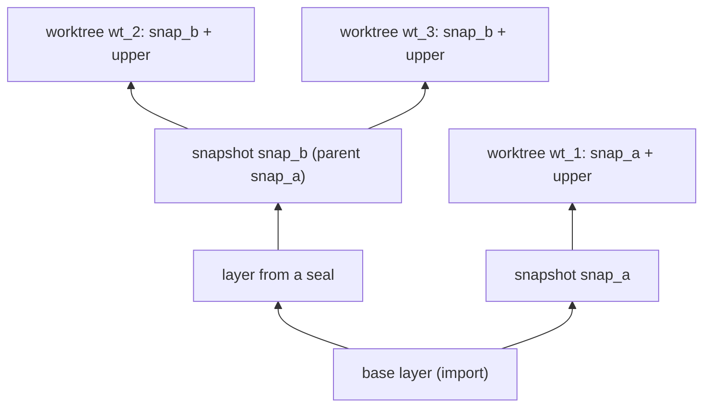

# Worktrees

A beavy worktree is a private, writable copy of a project that costs almost
nothing to create and that tools see at the project's usual path. Many can exist at
once, many commands can run in them at once, and each one's changes stay its own
until you seal them into a snapshot. On Linux this is built on kernel overlayfs,
mounted as root or inside an unprivileged user namespace.

This document explains the model, where the data lives, how a command enters a
worktree, what beavy needs from the machine, what happens when it's missing, and
what isn't built yet.

## The model

A **snapshot** is an immutable chain of layers. A layer is a directory tree in the
store that never changes once written.

- The first snapshot of a project is an **import**: beavy copies the project into
  the store as the chain's base layer. It clones files when the filesystem supports
  reflinks (XFS, btrfs) and copies them otherwise. This is the only full copy beavy
  ever makes. The project itself is only read: it's never a layer and never part
  of a mount, so editing it while worktrees run can't corrupt them.
- A **worktree** is a snapshot plus a private, initially empty upper layer.
  overlayfs presents the stack as one directory: reads fall through to the
  snapshot's layers, and writes, deletes, and renames land in the upper layer.
- **Sealing** a worktree turns its upper layer into the top layer of a new
  snapshot, with one rename and no copy. The worktree carries on from the new
  snapshot with a fresh upper layer, so nothing it shows changes. Any number of
  new worktrees can start from the sealed snapshot.



Deleting a snapshot or a worktree moves it to the store's trash with one rename,
whatever its size, so it's instant and reversible until `beavy trash empty`.
beavy refuses to delete a snapshot while a worktree or another snapshot depends on
it, and refuses to seal, mount, or delete a worktree while a command runs in it.

## The store

A store is an ordinary directory, by default outside the project under
`~/.local/share/beavy/stores`. beavy writes nothing anywhere else, never formats a
filesystem, loads a kernel module, or runs a daemon.

```text
store.json                     layout version
lock                           held briefly by every change
layers/<layer>/                immutable directory trees
snapshots/<id>.json            a snapshot: its layers, bottom first, and its parent
worktrees/<id>/worktree.json   a worktree: its snapshot
worktrees/<id>/upper/          the worktree's changes
worktrees/<id>/work/           overlayfs's scratch directory
worktrees/<id>/runs/<entry>    one per running command, locked while it runs
trash/<id>/                    deleted snapshots and worktrees
tmp/<entry>/                   work in progress, locked by the process doing it
```

The disk is the only source of truth; there's no database to drift from it. Every
change follows the same pattern:

1. Build the new thing under `tmp/`, in a directory the building process holds a
   lock on.
2. Move it into place with one `rename`, and write records atomically (write a
   temporary file, fsync, rename, fsync the directory).

A crash leaves either the old state or the new one, plus leftovers in `tmp/` that
no live process holds a lock on. Every command that changes the store takes the
store lock and repairs first: it removes unlocked leftovers, finishes or rolls back
an interrupted seal (seals keep a small journal for that), drops layers no snapshot
uses, and, as root, detaches mounts of worktrees that no longer exist.

Concurrent commands are safe. IDs are random, names are checked under the store
lock, and each worktree has its own upper layer, so two worktrees never share
writable state and concurrent creates never touch each other's directories.

## Running a command in a worktree

`beavy worktrees run <WORKTREE> -- <COMMAND>` runs the command with the worktree
mounted over the project's real path, in a mount namespace of its own:

1. beavy enters a new mount namespace (and, without root, a new user namespace),
   and marks every mount in it as a slave, so nothing it mounts leaks out while
   mounts the host makes later still reach it.
2. It mounts the worktree's stack over the directory the snapshot was imported
   from, then changes into the caller's directory again, so the working directory
   resolves through the new mount.
3. It replaces itself with the command (`execve`).

Because beavy becomes the command, the command keeps beavy's process ID, standard
streams, terminal, and signals, and its exit status is the caller's. Ctrl+C,
`kill`, job control, and pipes behave exactly as they do without beavy.

Entering at the real path is the main design decision. Tools bake absolute paths
into everything: pnpm's symlinks, TypeScript project references, build caches,
compiled binaries, editor state. A copy at a new path breaks or invalidates them;
the same path keeps every one of them valid. The mount is private, so other
processes, including other worktrees' commands at the same path, keep seeing their
own view.

Commands in the same worktree can run at once. Mounting the same upper layer twice
is undefined in overlayfs, so beavy never does: the first command mounts it, and
each later one joins the first one's namespaces with `setns` and sees the same
mount. Each running command holds a lock on its own file in `runs/`, inherited
across `exec`, which is how beavy knows a worktree is in use.

As root, `beavy worktrees mount <WORKTREE> <DIR>` also mounts a worktree for every
process, at a directory you choose. Commands started with `run` then bind that
mount instead of making a second one.

## Privilege modes

| Mode | When | Mounts in | Persistent mount |
| --- | --- | --- | --- |
| `root` | Effective user 0 with `CAP_SYS_ADMIN` | A private mount namespace | Yes |
| `userns` | Anyone else | A new user and mount namespace | No |

In `userns` mode the caller's user and group IDs map to themselves, not to root,
so a command sees its real UID and GID and the files it creates belong to the
caller. Files owned by users outside the mapping appear as `nobody`; a project
the caller owns is unaffected.

Both modes mount with the same options:

- **`userxattr`, always.** overlayfs records whiteouts, opaque directories, and
  other metadata in extended attributes, under `trusted.overlay.*` as root and
  `user.overlay.*` in a user namespace. A layer written under one namespace is
  misread under the other: opaque directories are ignored and deleted files
  reappear. Using `user.overlay.*` everywhere keeps every layer valid in both
  modes. It also turns off redirects and metacopy, so each layer holds whole files
  and never points into the layers below it. That's what makes it safe to
  rearrange layers when squashing.
- **`index=off`**, so a layer carries no file handles that tie it to the mount
  that wrote it.
- **Never `volatile`.** A worktree's upper layer is real data that must survive a
  crash.
- **Short layer paths.** The kernel caps mount options at one page on most
  versions. beavy mounts from the store's root with relative paths
  (`layers/abc123`), about 17 bytes per layer.

## Squashing

overlayfs searches every layer until it finds a name, so each layer adds a little
to every lookup that misses, and sealing adds a layer every time. When a seal would
make a chain deeper than 8 layers, beavy merges every layer above the base into
one, so the new chain is 2 layers deep. The base, usually the big import, is never
rewritten.

Layers never change, so the merged layer hard-links regular files from the layers
it merges instead of copying them. A squash costs one link per changed file, not a
copy per byte, and the result shows exactly what the stack showed: whiteouts and
opaque directories are kept wherever they hide something in the base.

Measured on the n8n tree from the [benchmark](#benchmark), with chains of sealed
layers built without squashing. Each layer holds an edit plus an incremental
rebuild of `packages/workflow`, a new directory, and a deleted one. Every number is
from a fresh mount (one `beavy worktrees run` each), in a user namespace:

| Layers | Typecheck cold / warm | Stat walk cold / page cache warm | git status warm |
| --- | --- | --- | --- |
| 2 | 23.8 / 3.68 s | 6.30 / 3.94 s | 0.32 s |
| 8 | 20.4 / 3.32 s | 6.24 / 4.05 s | 0.32 s |
| 16 | 20.4 / 3.46 s | 6.24 / 3.93 s | 0.35 s |
| 32 | 23.1 / 3.29 s | 6.29 / 3.89 s | 0.33 s |
| 64 | 20.1 / 3.20 s | 6.54 / 3.96 s | 0.34 s |

Nothing grows with depth up to 64 layers here; run-to-run noise is larger than
any trend. An earlier experiment on a different machine saw the first cold
typecheck after mounting 50 or more layers take about 25 s instead of 4 s, and
never found the cause. beavy still squashes at 8 because squashing is cheap:
merging 65 layers into one took 0.75 s, against 16 ms for a plain seal. Keeping
chains short stays far from that unexplained cliff, bounds the per-lookup cost,
and keeps mount options small, for less than a second every few seals.

## Failure modes

Every failure is an error with a stable reason, an exit code, and, when beavy can
tell, the exact command that fixes it.

| Situation | What beavy does |
| --- | --- |
| Not root, and unprivileged user namespaces are blocked: Ubuntu 23.10 and later, including GitHub's Ubuntu 24.04 runners, through AppArmor | `backend_unavailable`, next: `sudo sysctl -w kernel.apparmor_restrict_unprivileged_userns=0` |
| User namespaces disabled by `kernel.unprivileged_userns_clone=0` or `user.max_user_namespaces=0` | `backend_unavailable` with the matching `sysctl` |
| Inside a Docker container with the default profile, which blocks `mount` and `unshare` | `backend_unavailable`; the message names `--cap-add SYS_ADMIN --security-opt apparmor=unconfined --security-opt seccomp=unconfined` |
| Store on overlayfs, such as a container's root filesystem | A `store_on_overlayfs` warning when mounting works, `backend_unavailable` naming a store on a volume or tmpfs when it doesn't |
| Kernel without overlayfs | `backend_unavailable`. beavy never loads modules |
| macOS and other platforms | `backend_unavailable` from every snapshot, worktree, and trash command |
| The project directory was moved or deleted | `not_found` from `run`: a worktree runs at the path its snapshot was imported from |
| A command in the worktree is still running | `worktree_in_use` from seal, mount, unmount, and delete, naming the processes |
| beavy is killed mid-command | The next change to the store repairs it; nothing half-made is ever listed |

`beavy worktrees create` mounts every new worktree once in a throwaway namespace
before recording it, so these failures show up when you create a worktree, not
halfway through an agent's run. `beavy host check` reports the same facts without
changing anything.

Some limits are inherent to overlayfs. Copying up a file that was hard-linked in a
lower layer gives the worktree its own copy, so hard links don't span the boundary.
A command that closes every inherited file descriptor drops its run lock, and beavy
then treats the worktree as idle while it still runs. Renaming a directory that
exists in a lower layer fails with `EXDEV`, which `mv` and most tools handle by
copying.

## Compared with rift

[rift](https://github.com/anomalyco/rift) makes copy-on-write workspaces with
reflinks, btrfs snapshots, or APFS `clonefile`. beavy takes several ideas from it:

- **Git state is copied, not recreated.** The imported copy has a detached HEAD
  at the current commit with the index and working tree intact, and beavy refuses
  linked worktrees and repositories in the middle of a merge, rebase, cherry-pick,
  revert, or bisect.
- **Deleting is moving to the trash,** and emptying the trash is a separate,
  confirmed step.
- **Concurrency guarantees:** workspaces never overlap, and concurrent creates never
  clobber each other.
- **stdout carries only the identifier** a script needs, with everything else on
  stderr.

beavy differs on purpose in two places:

- **Same path, not a new one.** rift workspaces are directories next to the
  project, so every absolute path inside them points back at the original. beavy
  mounts each worktree over the original path in a private namespace, so caches,
  symlinks, and compiled paths stay valid and no tool needs to know it's in a
  worktree. The cost is that a worktree is visible only to commands started
  through beavy, or to everyone at a separate path with a root mount.
- **Sealed snapshots, not clones of clones.** A rift workspace is a clone of
  another live directory. beavy separates the immutable history (snapshots) from
  the mutable state (worktrees), so starting a worktree costs the same whether
  the project has 1,000 files or 400,000, a finished worktree can become the
  starting point for many others, and nothing ever copies node_modules again
  after the import.

## Benchmark

Measured on a 4-CPU, 15 GB machine with Linux 6.1 and ext4, which has no
reflinks, on [n8n](https://github.com/n8n-io/n8n) at `83efca231eef` with
dependencies installed and every package built: 388,848 entries, 3.2 GB. Every
number is from a release build.

| Operation | Time | Extra disk |
| --- | --- | --- |
| Import the project (first snapshot, a full copy on ext4) | 39.0 s | 3.95 GB |
| Create a worktree | 21 ms cold, 6 ms warm (median of 5) | 4 KB |
| Start a command: `beavy worktrees run <WORKTREE> -- true` | 7 ms in a user namespace, 16 ms as root through `sudo` | |
| Edit a file and rebuild `packages/workflow` in a worktree | 1.38 s | 11.4 MB in the upper layer |
| Seal the worktree into a snapshot | 9 ms | 8 KB |
| Create a worktree of the sealed snapshot | 5 ms | |
| Delete a worktree (to the trash) | 3 ms | |

The sealed snapshot showed the edit and the rebuilt output, and the real tree was
unchanged.

Inside against outside, cold means after dropping the page cache:

| Workload | Outside | Worktree, user namespace | Worktree, root |
| --- | --- | --- | --- |
| Typecheck, `packages/cli` `tsc --noEmit`, cold / warm | 22.0 / 3.27–3.46 s | 20.6 / 3.38–3.48 s | 22.4 / 3.70–3.82 s |
| Tests, `vitest run test/expression` in `packages/workflow`, warm | 24.4–24.8 s | 24.7–25.2 s | 25.0–25.4 s |
| Stat of every entry, cold / again in a new run | 3.69 / 1.54 s | 6.51 / 3.94 s | 6.39 / 4.06 s |
| Stat of every entry, repeated within one run | 1.30–1.42 s | 1.75 s | |
| `git status`, first / later | 0.27 / 0.15 s | 4.00 / 0.32 s | 4.28 / 0.36 s |

Typecheck and tests, the work agents spend their time on, run within about 3% of
the original tree in a user namespace, and within about 10% as root. Two costs are
real:

- **Each run starts with a cold overlay cache.** A run gets a new mount, and
  overlayfs's own inode cache dies with it, so the first walk over every entry in a
  run costs about 2.5 times the original tree's, even with the page cache warm.
  Repeated walks within one run cost about 25% more, the same as the earlier
  experiment measured (1.69 against 1.26 s).
- **The first `git status` in a new worktree reads every tracked file.** The
  copy's inode numbers and change times don't match what Git's index recorded, so
  Git rehashes everything once, then writes the refreshed index into the worktree.
  Later runs, and worktrees of snapshots sealed after that, are fast.

Against the earlier experiment, which mounted overlayfs by hand on the same tree:
create was 22 ms there and 21 ms here, extra disk 0 there and 4 KB here (the
worktree's directories and record), and a seal 64 ms there, including an unmount
and a remount, against 9 ms here.

## Not built yet

- **A copy or reflink backend** for machines with neither root nor user
  namespaces, and **APFS `clonefile`** on macOS. Until then these machines get
  `backend_unavailable` with the fix.
- **Lifecycle hooks** around create and delete, such as installing dependencies or
  starting services per worktree.
- **Shell integration** and a **JavaScript API**.
- **Garbage collection beyond the trash.** Snapshots stay until deleted, and the
  trash stays until emptied.
- **Bringing changes back.** beavy records the commit a snapshot was taken at and
  nothing else about Git; moving work out of a worktree is up to Git or the agent.
- **Keeping a worktree's mount alive between runs**, so overlayfs's cache stays
  warm. It needs a process to hold the namespace open, which beavy avoids.
- **Refreshing Git's index at import**, which would make the first `git status`
  in a new worktree as fast as later ones. It means running Git during the import.
- **Refreshing a running worktree's base.** A new import is a new snapshot, and
  existing worktrees keep the snapshot they started from.
